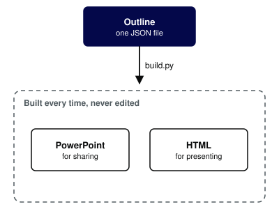
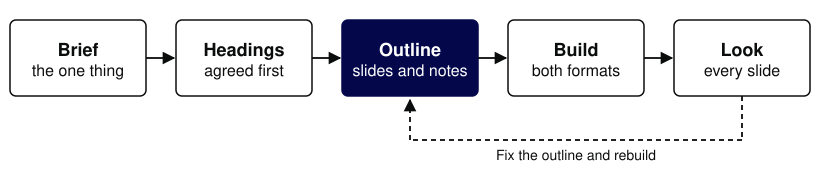

# Making GDS slides with Claude
Presenter: Maxwell Riess
Role: Lead Product Manager
Organisation: Government Digital Service
Sizes: heading 26, body 16, section 48
Notes: Example of the table, split and diagram slide types, at the lighter type sizes. Run examples/diagrams/make.py before building.

## Decks drift when every copy is edited by hand
The outline is the master copy. Change it and rebuild, and the PowerPoint file and the HTML deck stay the same.

Notes: A plain text slide with a body sentence.

## [split] One outline builds both formats
### How it works
Write the deck as a Markdown outline. The build script turns it into a PowerPoint file and an HTML deck.

### Why this way
- One place to change the story
- Both formats always agree
- Speaker notes travel with the slides

Notes: A split slide: labelled text on the left, a diagram on the right.

## [diagram] Five steps from brief to deck
Agree the headings before writing the outline. Fixing the story then costs nothing.

Notes: A full-width diagram slide with a lead sentence.

## [table] Pick the slide type for the point you are making
| Slide type | Use it for |
|---|---|
| text | One point, with a sentence or a short list |
| table | A comparison, or a split of responsibilities |
| split | How something works beside why it works that way |
| diagram | A model, a flow or a relationship |
| section | A signpost between parts of the argument |

Notes: A table slide. The first column is bold.
