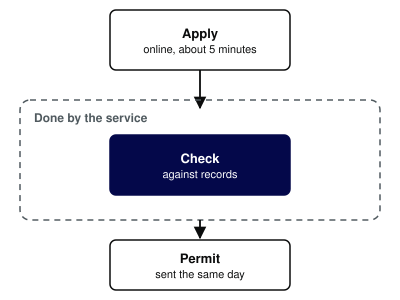
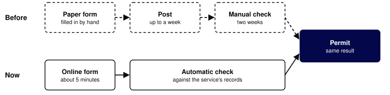

# Renew a permit: quarterly update
Presenter: Alex Example
Role: Product Manager
Organisation: Government Digital Service
Sizes: heading 26, body 16, section 48
Notes: A made-up service, used to show the table, split and diagram slide types at lighter type sizes. Run examples/diagrams/make.py before building. After upgrading python-pptx, build this deck and open it in PowerPoint for the web.

## Most people now renew online
Paper renewals fell this quarter, and online renewals now take minutes rather than weeks.

Notes: A plain text slide with a body sentence.

## [split] Renewal now takes three steps
### How it works
People apply online. The service checks the application against its own records, so nobody has to send documents.

### What changed
- No paper form
- No documents to post
- The permit arrives the same day

Notes: A split slide: labelled text on the left, a diagram on the right.

## [diagram] Two routes to the same permit
The paper route still works. Most people now take the shorter one.

Notes: A full-width diagram slide with a lead sentence, at the lighter sizes. Dashed lines show the old route.

## [table] What changed this quarter
| Measure | This quarter |
|---|---|
| Applied online | Most applications, up from under half |
| Time to a decision | Minutes, down from three weeks |
| Calls to the helpline | Down, mostly about payment |
| Paper forms | Still accepted, on request |

Notes: A table slide. The first column is bold. The figures are made up.
