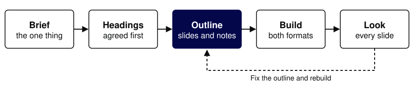
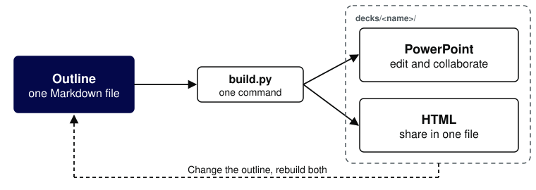

# How to make GDS slides with Claude
Presenter: Maxwell Riess
Role: Lead Product Manager
Organisation: Government Digital Service
Notes: How the gds-slides plugin works and how to use it. Also the example outline for every slide type at the default sizes. Run examples/diagrams/make.py before building it.

## Decks drift when every copy is edited by hand
A fix made in one copy never reaches the others. Here, Claude builds every version of a deck from one outline, so there is only one place to change.

Notes: The problem the plugin solves. The PowerPoint file and the HTML deck are both built from the outline, never edited separately.

## Describe the deck, and Claude builds it in the GDS template
Give Claude your notes and the point you want to make. It agrees the headings with you, then builds a PowerPoint file and an HTML deck.

Notes: The plugin is a Claude Code skill. It works from whatever you point it at: notes, documents, a brief.

## [section] Getting started
Notes: A section slide: one short line that signposts what follows.

## Set it up once
- Install it from govuk-once/gds-claude-plugins
- Or work in a repo that already includes it
- Ask Claude to run the gds-slides setup check

Notes: Install with /plugin marketplace add govuk-once/gds-claude-plugins, then /plugin install gds-slides@gds-claude-plugins. The setup check reports anything missing and how to fix it. Python 3 is enough for HTML decks; PowerPoint needs python-pptx, and previews need DeckCraft.

## Ask for a deck in plain words
“Make a GDS deck for Thursday's show and tell on what we learnt from the beta. Here are my notes.”

Notes: Say who the deck is for if you can, and point Claude at the documents it should draw on.

## [diagram] Five steps from brief to deck
Claude agrees the headings with you before it writes the outline, so changing the story costs nothing.

Notes: Brief: who the deck is for and the one thing they should take away. Headings: for you to approve. Outline: a Markdown file you can read and edit, a heading per slide, with detail in the speaker notes. Build: both formats at once. Look: Claude checks every slide and fixes the outline until they all pass.

## [table] Pick the slide for the point
| Ask for | You get |
|---|---|
| A table | A comparison, ruled like this one |
| A quote or callout | One line set large, with who said it |
| Text over an image | A short line on the template photo |
| A diagram | A flow or model, drawn in the GDS style |
| Text and a diagram | How it works, next to the picture |

Notes: A table slide. The next three slides are examples of a callout, text over an image and a diagram. Ask in plain words, for example: make slide 4 a table comparing the two options.

## [quote]
> Make a document instead of a slide deck if you are trying to say too much.

Source: The GDS slide template

Notes: A quote slide, for a callout or something a user said. Keep it to one or two lines.

## [photo] One outline. Two formats.
Notes: Text over an image: a photo section slide. Use it at most once a deck.

## [diagram] One outline, both versions
One command builds both files from the outline.

Notes: A diagram slide. Both files land in decks/<name>/, beside the outline. Diagrams are drawn as SVG by a short script kept with the deck.

## [table] Each format does its own job
| Format | Use it to |
|---|---|
| PowerPoint | Make fine-grained edits, comment and work on the deck together |
| HTML | Share quickly: one file that opens in any browser, with nothing to install |

Notes: Share the PowerPoint file when people need to edit or comment, in PowerPoint for the web. Send the HTML file when they only need to read or present it: P presents, N shows speaker notes, arrow keys move.

## To change a deck, change the outline
Ask Claude to edit the outline, or edit it yourself, then rebuild. Polish in PowerPoint once the story is settled, because a rebuild replaces those edits.

Notes: The outline is the master copy, so the two formats never drift apart. Edits made only in PowerPoint stay in that file.

## Good to know
- OFFICIAL material only
- Open an important deck in PowerPoint first
- Diagrams reach PowerPoint as pictures

Notes: Every slide is marked OFFICIAL. PowerPoint can wrap text slightly differently from the HTML deck. To change a diagram, change its SVG and rebuild.
