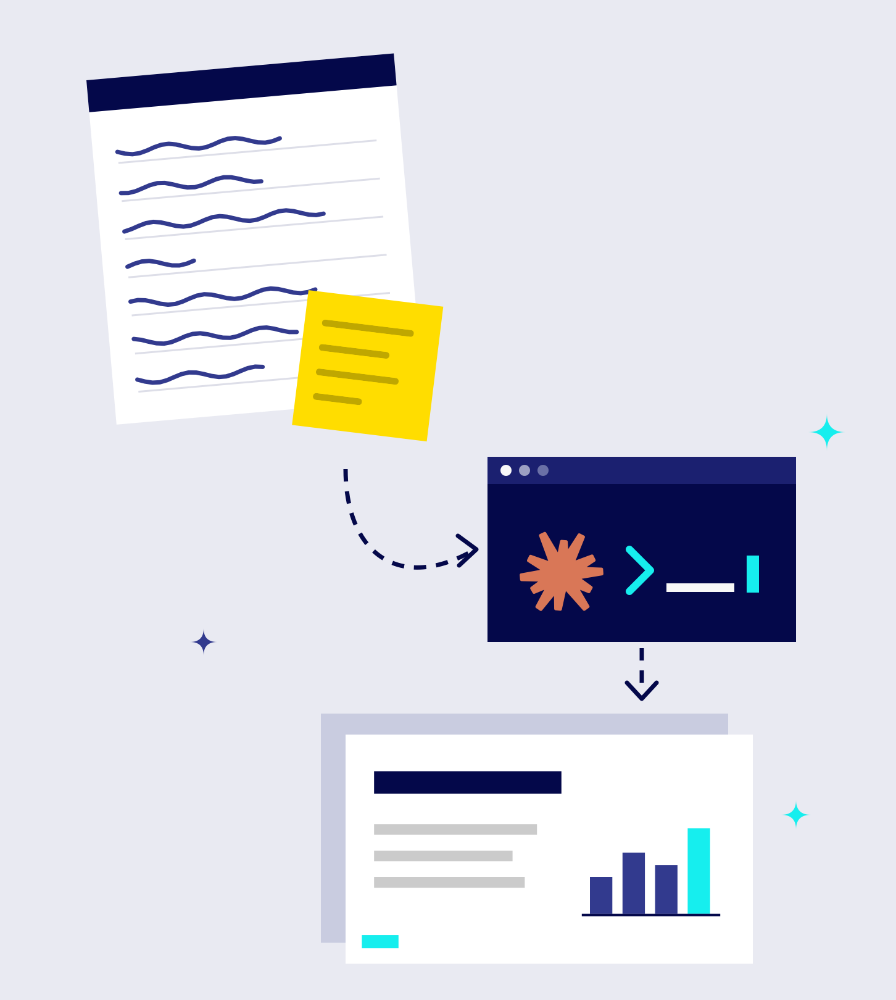
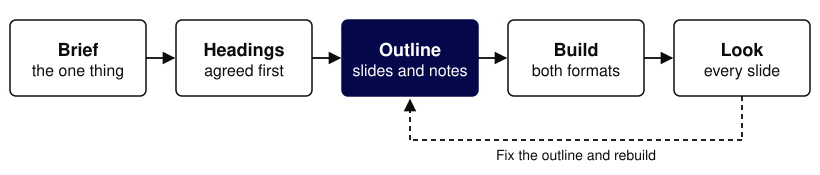
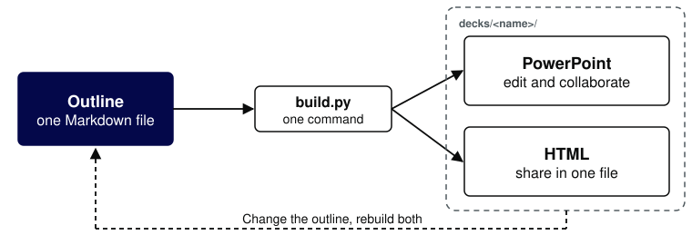
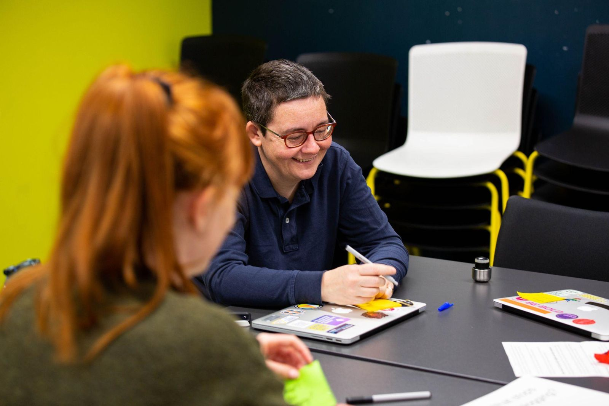
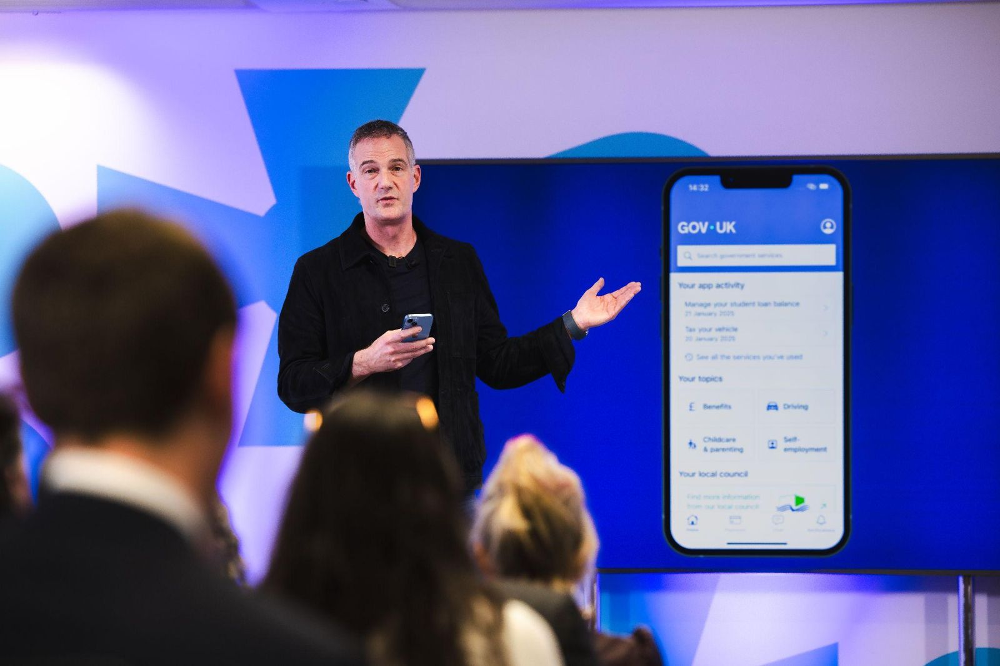

# How to make GDS slides with Claude
Presenter: Maxwell Riess
Role: Lead Product Manager
Organisation: Government Digital Service
Cover: images/cover-claude-slides.png
Notes: How the gds-slides plugin works and how to use it. Also the example outline for every slide type at the default sizes. Run examples/diagrams/make.py before building it. The photos are the GDS slide template's own, and the two illustrations are drawn by examples/images/make.py, all in examples/images.

## Claude turns your notes into a deck with GDS branding
Making slides in the GDS template is easy, and going from a set of notes to a finished deck is much faster than building it by hand.

Notes: The point of the plugin. The rest of the deck shows how it works, and doubles as an example of every slide type. The title slide has a cover photo: add a Cover line under the deck title.

## [image] Describe the deck, and Claude builds it
Give Claude your notes. It agrees the headings, then builds the deck.

Notes: An image slide: text on the left, your photo or screenshot filling the right half. The plugin is a Claude Code skill. It works from whatever you point it at: notes, documents, a brief.

## [section] Getting started
Notes: A section slide: one short line that signposts what follows.

## [numbered] Set it up once

### Install it
From govuk-once/gds-claude-plugins, with two commands.

### Or use a repo
Some repos already include it, such as personalised-planning.

### Run the check
Ask Claude to run the gds-slides setup check.

Notes: Numbered cards, for steps or requirements. Install with /plugin marketplace add govuk-once/gds-claude-plugins, then /plugin install gds-slides@gds-claude-plugins. The setup check reports anything missing and how to fix it. Python 3 is enough for HTML decks; PowerPoint needs python-pptx, photos need Pillow, and previews need DeckCraft.

## Ask for a deck in plain words
“Make a GDS deck for Thursday's show and tell on what we learnt from the beta. Here are my notes and some photos.”

Notes: Say who the deck is for if you can, point Claude at the documents it should draw on, and give it any photos or screenshots you want in the deck.

## [diagram] Five steps from brief to deck
Claude agrees the headings with you before it writes the outline, so changing the story costs nothing.

Notes: Brief: who the deck is for and the one thing they should take away. Headings: for you to approve. Outline: a Markdown file you can read and edit, a heading per slide, with detail in the speaker notes. Build: both formats at once. Look: Claude checks every slide and fixes the outline until they all pass.

## [table] Pick the slide for the point
| Ask for | You get |
|---|---|
| A sentence or a short list | A text slide, like the last one |
| A comparison | A table, ruled like this one |
| One line said large | A quote, with who said it |
| A flow or a model | A diagram, drawn in the GDS style |
| A photo or a screenshot | An image slide, or a photo behind a section |

Notes: A table slide. Ask in plain words, for example: make slide 4 a table comparing the two options.

## [cards] Break a point into parts
Cards suit a few things that sit side by side.

### Cards
Two to four panels, each a title and a sentence or list.
Evidence: A muted line holds the figure or source.

### Numbered cards
The same panels, numbered, for steps or requirements.

### Scorecards
A table where cells say yes, partly or no, with a short note.

! **A callout** holds the takeaway the reader must not miss. One a slide at most.

Notes: A cards slide with a lede, an evidence line and a callout. For a deck people will read on screens rather than watch, add Density: discuss under the title for smaller type and more words a slide.

## [quote]
> Make a document instead of a slide deck if you are trying to say too much.

Source: The GDS slide template

Notes: A quote slide, for a callout or something a user said. Keep it to one or two lines.

## [photo] One outline. Two formats.

Notes: Text over an image: a photo section slide, with your own photo under the navy tint. Leave the image line out to use the template's photo. Use it at most once a deck.

## [diagram] One outline, both versions
One command builds both files from the outline.

Notes: A diagram slide. Both files land in decks/<name>/, beside the outline. Diagrams are drawn as SVG by a short script kept with the deck. Diagram and split slides also take a PNG or JPEG, for screenshots.

## [table] Each format does its own job
Work on the PowerPoint file. Show the HTML file.

| What you need | PowerPoint | HTML {highlight} |
|---|---|---|
| Edit in fine detail | [yes] | [no] |
| Comment together | [yes] in PowerPoint for the web | [no] |
| Share as one file | [partly] needs Office | [yes] any browser |
| Present with notes | [yes] | [yes] P presents, N for notes |

Notes: A scorecard table. Share the PowerPoint file when people need to edit or comment, in PowerPoint for the web. Send the HTML file when they only need to read or present it: P presents, N shows speaker notes, arrow keys move.

## [photos] Photos for visual interest

Notes: A photo slide: two or three photos on the template's cyan frame, or navy with {navy} after the heading. The heading isn't shown; it names the slide for screen readers and the notes. Photos are cropped from the centre to fill their frame.

## To change a deck, change the outline
Ask Claude to edit the outline, or edit it yourself, then rebuild. Both formats stay the same.

! **Changed it in PowerPoint?** Claude edits that file in place instead, so your changes stay.

Notes: The outline is the master copy until someone edits the PowerPoint file by hand. From then on Claude changes the PowerPoint file itself: wording, speaker notes, hiding and reordering slides, and it checks the result against a backup slide by slide.

## Good to know
- OFFICIAL material only
- Open an important deck in PowerPoint first
- Photos are cropped to fill their frame
- Diagrams reach PowerPoint as pictures

Notes: Every slide is marked OFFICIAL. PowerPoint can wrap text slightly differently from the HTML deck. Crop a photo yourself first if its subject is near the edge. To change a diagram, change its SVG and rebuild.
