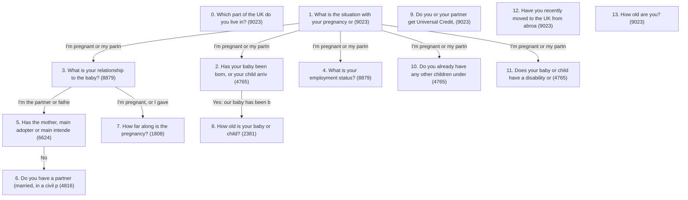

# baby — elicitation model

## Branching

Reach = how many of 9023 sampled profiles are asked each question.

| # | question | reach | asked when |
|---|---|---|---|
| 0 | `q_nation` | 9023 (100%) | always |
| 1 | `q_pregnancy_outcome` | 9023 (100%) | always |
| 2 | `q_baby_stage` | 4765 (53%) | q_pregnancy_outcome = I'm pregnant (or my partner is), or our baby is alive |
| 3 | `q_relationship_to_baby` | 8879 (98%) | q_pregnancy_outcome in [I'm pregnant (or my partner is), or our baby is alive, Our baby was stillborn at 24 weeks of pregnancy or later, Our baby died after being born] |
| 4 | `q_employment_status` | 8879 (98%) | q_pregnancy_outcome in [I'm pregnant (or my partner is), or our baby is alive, Our baby was stillborn at 24 weeks of pregnancy or later, Our baby died after being born] |
| 5 | `q_partner_died` | 6624 (73%) | q_relationship_to_baby in [I'm the partner or father of the person giving birth, I'm adopting, or fostering to adopt, I'm having a baby through a surrogacy arrangement] |
| 6 | `q_has_partner` | 4816 (53%) | q_pregnancy_outcome = The pregnancy ended before 24 weeks or q_relationship_to_baby = I'm pregnant, or I gave birth to the baby or q_relationship_to_baby in [I'm adopting, or fostering to adopt, I'm having a baby through a surrogacy arrangement] and q_partner_died = No |
| 7 | `q_pregnancy_timing` | 1808 (20%) | q_baby_stage = Not yet: we're expecting a baby or waiting for a child to arrive and q_relationship_to_baby in [I'm pregnant, or I gave birth to the baby, I'm the partner or father of the person giving birth, I'm having a baby through a surrogacy arrangement] |
| 8 | `q_baby_age` | 2381 (26%) | q_baby_stage = Yes: our baby has been born, or our child has been placed with us |
| 9 | `q_qualifying_benefits` | 9023 (100%) | always |
| 10 | `q_other_children_under_16` | 4765 (53%) | q_pregnancy_outcome = I'm pregnant (or my partner is), or our baby is alive |
| 11 | `q_child_disability` | 4765 (53%) | q_pregnancy_outcome = I'm pregnant (or my partner is), or our baby is alive |
| 12 | `q_moving` | 9023 (100%) | always |
| 13 | `q_parent_age` | 9023 (100%) | always |

## Questions
### 0. q_nation (single_select) — _source:_ /sure-start-maternity-grant/eligibility, /healthy-start, /free-childcare-if-working/overview, /register-birth/overview, /disability-living-allowance-children/overview
Which part of the UK do you live in?
- `england` England
- `wales` Wales
- `scotland` Scotland
- `northern_ireland` Northern Ireland
### 1. q_pregnancy_outcome (single_select) — _source:_ /request-baby-loss-certificate, /register-stillbirth, /after-a-death/if-a-child-or-baby-dies, /sure-start-maternity-grant/eligibility
What is the situation with your pregnancy or baby?
- `ongoing_or_born_alive` I'm pregnant (or my partner is), or our baby is alive _(needs_evidence)_
- `loss_before_24_weeks` The pregnancy ended before 24 weeks
- `stillbirth_24_weeks_plus` Our baby was stillborn at 24 weeks of pregnancy or later
- `died_after_birth` Our baby died after being born
### 2. q_baby_stage (single_select) — ask_if `{"==": ["q_pregnancy_outcome", "ongoing_or_born_alive"]}` — _source:_ /maternity-pay-leave/overview, /register-birth/overview, /sure-start-maternity-grant/how-to-claim, /child-benefit/how-to-claim
Has your baby been born, or your child arrived, yet?
- `expecting` Not yet: we're expecting a baby or waiting for a child to arrive
- `born` Yes: our baby has been born, or our child has been placed with us
### 3. q_relationship_to_baby (single_select) — ask_if `{"in": ["q_pregnancy_outcome", ["ongoing_or_born_alive", "stillbirth_24_weeks_plus", "died_after_birth"]]}` — _source:_ /maternity-pay-leave/eligibility, /paternity-pay-leave/eligibility, /maternity-pay-leave/overview, /paternity-pay-leave/overview, /shared-parental-leave-and-pay/eligibility-for-adopters, /paternity-pay-leave/adoption
What is your relationship to the baby?
- `giving_birth` I'm pregnant, or I gave birth to the baby _(needs_evidence)_
- `partner` I'm the partner or father of the person giving birth _(needs_evidence)_
- `adopting` I'm adopting, or fostering to adopt _(needs_evidence)_
- `surrogacy` I'm having a baby through a surrogacy arrangement _(needs_evidence)_
### 4. q_employment_status (single_select) — ask_if `{"in": ["q_pregnancy_outcome", ["ongoing_or_born_alive", "stillbirth_24_weeks_plus", "died_after_birth"]]}` — _source:_ /employment-status/employee, /employment-status/worker, /maternity-pay-leave/eligibility, /maternity-allowance/eligibility, /maternity-allowance/overview
What is your employment status?
- `employee` Employee (I work under an employment contract) _(needs_evidence)_
- `worker` Worker (for example casual, agency or zero-hours)
- `self_employed` Self-employed
- `not_working` Not currently working
### 5. q_partner_died (single_select) — ask_if `{"in": ["q_relationship_to_baby", ["partner", "adopting", "surrogacy"]]}` — _source:_ /bereaved-partners-paternity-leave/overview, /bereaved-partners-paternity-leave/eligibility, /widowed-parents-allowance/eligibility, /guardians-allowance/overview
Has the mother, main adopter or main intended parent of your child died?
- `yes` Yes _(needs_evidence)_
- `no` No
### 6. q_has_partner (single_select) — ask_if `{"or": [{"==": ["q_pregnancy_outcome", "loss_before_24_weeks"]}, {"==": ["q_relationship_to_baby", "giving_birth"]}, {"and": [{"in": ["q_relationship_to_baby", ["adopting", "surrogacy"]]}, {"==": ["q_partner_died", "no"]}]}]}` — _source:_ /universal-credit/eligibility, /shared-parental-leave-and-pay/how-it-works, /paternity-pay-leave/eligibility, /child-benefit-tax-charge/overview
Do you have a partner (married, in a civil partnership, or living together as a couple)?
- `yes` Yes
- `no` No
### 7. q_pregnancy_timing (single_select) — ask_if `{"and": [{"==": ["q_baby_stage", "expecting"]}, {"in": ["q_relationship_to_baby", ["giving_birth", "partner", "surrogacy"]]}]}` — _source:_ /maternity-allowance/how-to-claim, /maternity-pay-leave/how-to-claim, /maternity-pay-leave/leave, /sure-start-maternity-grant/how-to-claim
How far along is the pregnancy?
- `under_26_weeks` Less than 26 weeks pregnant
- `26_weeks_to_11_before_due` 26 weeks or more, but more than 11 weeks before the due date
- `within_11_weeks_of_due` 11 weeks or less before the due date
### 8. q_baby_age (single_select) — ask_if `{"==": ["q_baby_stage", "born"]}` — _source:_ /sure-start-maternity-grant/how-to-claim, /free-childcare-if-working/overview
How old is your baby or child?
- `under_6_months` Under 6 months
- `6_to_9_months` 6 months to under 9 months
- `9_months_or_older` 9 months or older
### 9. q_qualifying_benefits (single_select) — _source:_ /sure-start-maternity-grant/eligibility, /healthy-start, /help-with-childcare-costs/free-childcare-2-year-olds-extra-support, /apply-free-school-meals, /universal-credit/eligibility
Do you or your partner get Universal Credit, income-related Employment and Support Allowance, Pension Credit or another income-related benefit?
- `yes` Yes
- `no` No
### 10. q_other_children_under_16 (single_select) — ask_if `{"==": ["q_pregnancy_outcome", "ongoing_or_born_alive"]}` — _source:_ /sure-start-maternity-grant/eligibility, /sure-start-maternity-grant/what-youll-get
Do you already have any other children under 16?
- `yes` Yes
- `no` No, this is my first child
### 11. q_child_disability (single_select) — ask_if `{"==": ["q_pregnancy_outcome", "ongoing_or_born_alive"]}` — _source:_ /disability-living-allowance-children/overview, /help-for-disabled-child/overview, /help-with-childcare-costs/free-childcare-2-year-olds-extra-support, /universal-credit/what-youll-get
Does your baby or child have a disability or long-term health condition?
- `yes` Yes _(needs_evidence)_
- `no` No
- `not_known` Not known yet
### 12. q_moving (single_select) — _source:_ /child-benefit-move-to-uk, /child-benefit-abroad, /tax-right-retire-abroad-return-to-uk
Have you recently moved to the UK from abroad, or are you planning to move abroad?
- `moved_to_uk` I recently moved to the UK from abroad
- `moving_abroad` I'm moving abroad, or planning to
- `neither` Neither
### 13. q_parent_age (single_select) — _source:_ /child-benefit/what-youll-get, /child-benefit/how-to-claim, /universal-credit/eligibility
How old are you?
- `under_16` Under 16
- `16_to_17` 16 or 17
- `18_or_over` 18 or over

## Option filters
- `q_child_disability.not_known` shown_if `{"==": ["q_baby_stage", "expecting"]}`
- `q_relationship_to_baby.adopting` shown_if `{"in": ["q_pregnancy_outcome", ["ongoing_or_born_alive", "died_after_birth"]]}`

## Facts
- **fact_lives_england** This person lives in England, so England-only schemes such as Free Childcare for Working Parents apply. = `{"==": ["q_nation", "england"]}` — _source:_ /free-childcare-if-working/overview
- **fact_lives_wales** This person lives in Wales, so Welsh childcare and early-years schemes apply instead of the England-only ones. = `{"==": ["q_nation", "wales"]}` — _source:_ /free-childcare-if-working/overview
- **fact_lives_scotland** This person lives in Scotland, so they use Scottish schemes instead of the GOV.UK ones (for example the Pregnancy and Baby Payment instead of the Sure Start Maternity Grant, Best Start Foods instead of Healthy Start, Child Disability Payment instead of DLA for children, and Scottish registration rules). = `{"==": ["q_nation", "scotland"]}` — _source:_ /sure-start-maternity-grant/eligibility, /healthy-start, /disability-living-allowance-children/overview, /register-stillbirth
- **fact_lives_northern_ireland** This person lives in Northern Ireland, so Northern Ireland schemes and services (nidirect) apply instead of the England and Wales ones, including different registration deadlines. = `{"==": ["q_nation", "northern_ireland"]}` — _source:_ /free-childcare-if-working/overview, /disability-living-allowance-children/overview, /register-stillbirth
- **fact_pregnant_or_baby_alive** This person's pregnancy is ongoing or their baby or child is alive, so the standard maternity, paternity, adoption, registration and claims guidance applies. = `{"==": ["q_pregnancy_outcome", "ongoing_or_born_alive"]}` — _source:_ /maternity-pay-leave/overview, /paternity-pay-leave/overview, /child-benefit/how-to-claim
- **fact_loss_before_24_weeks** This person's pregnancy ended before 24 weeks, so they may request a baby loss certificate but cannot register a stillbirth or claim Child Benefit for the baby. = `{"==": ["q_pregnancy_outcome", "loss_before_24_weeks"]}` — _source:_ /request-baby-loss-certificate, /register-stillbirth
- **fact_stillbirth** This person's baby was stillborn at 24 weeks or later, so they must register a stillbirth and may still be entitled to maternity or paternity pay and leave, but cannot claim Child Benefit. = `{"==": ["q_pregnancy_outcome", "stillbirth_24_weeks_plus"]}` — _source:_ /register-stillbirth, /after-a-death/if-a-child-or-baby-dies
- **fact_baby_died_after_birth** This person's baby died after being born, so they must register the death, may still get maternity or paternity leave and pay, and Child Benefit continues for up to 8 weeks. = `{"==": ["q_pregnancy_outcome", "died_after_birth"]}` — _source:_ /after-a-death/if-a-child-or-baby-dies, /child-benefit-child-parent-dies/if-a-child-dies
- **fact_baby_born** This person's baby has been born or their child has been placed with them, so time-limited tasks counted from that date (registering the birth, claiming Child Benefit, the grant deadline) are now running. = `{"==": ["q_baby_stage", "born"]}` — _source:_ /register-birth/overview, /child-benefit/how-to-claim, /sure-start-maternity-grant/how-to-claim
- **fact_is_birth_parent** This person is pregnant or gave birth, so maternity leave, Statutory Maternity Pay and Maternity Allowance rules apply to them rather than paternity rules. = `{"==": ["q_relationship_to_baby", "giving_birth"]}` — _source:_ /maternity-pay-leave/overview, /maternity-allowance/overview
- **fact_is_partner** This person is the partner or father of the person giving birth, so Paternity Leave and Pay and Shared Parental Leave rules apply to them rather than maternity rules. = `{"==": ["q_relationship_to_baby", "partner"]}` — _source:_ /paternity-pay-leave/eligibility, /shared-parental-leave-and-pay/how-it-works
- **fact_adopting_or_surrogacy** This person is adopting or having a baby through surrogacy, so adoption-specific leave and pay rules and surrogacy rules (such as parental orders) apply rather than maternity ones. = `{"in": ["q_relationship_to_baby", ["adopting", "surrogacy"]]}` — _source:_ /shared-parental-leave-and-pay/eligibility-for-adopters, /paternity-pay-leave/adoption
- **fact_is_employee** This person is classed as an employee, so statutory family leave and pay (maternity, paternity, adoption, shared parental, neonatal) may apply to them. = `{"==": ["q_employment_status", "employee"]}` — _source:_ /employment-status/employee, /maternity-pay-leave/eligibility
- **fact_birth_parent_employee** This person is an employee who is pregnant or gave birth, so they may qualify for Statutory Maternity Leave and Pay. = `{"and": [{"==": ["q_relationship_to_baby", "giving_birth"]}, {"==": ["q_employment_status", "employee"]}]}` — _source:_ /maternity-pay-leave/eligibility
- **fact_may_get_maternity_allowance** This person is pregnant or gave birth but is not an employee, so they cannot get Statutory Maternity Pay but may get Maternity Allowance instead. = `{"and": [{"==": ["q_relationship_to_baby", "giving_birth"]}, {"!=": ["q_employment_status", "employee"]}]}` — _source:_ /maternity-allowance/overview, /maternity-allowance/eligibility
- **fact_has_partner** This person has a partner (they said so, or they are the partner of the person giving birth and that person is alive), which makes Universal Credit a joint claim, affects who pays the High Income Child Benefit Charge, and is needed for Shared Parental Leave. = `{"or": [{"==": ["q_has_partner", "yes"]}, {"and": [{"==": ["q_relationship_to_baby", "partner"]}, {"==": ["q_partner_died", "no"]}]}]}` — _source:_ /universal-credit/eligibility, /child-benefit-tax-charge/overview, /shared-parental-leave-and-pay/how-it-works
- **fact_partner_died** The mother, main adopter or main intended parent of this person's child has died, so they may be eligible for Bereaved Partner's Paternity Leave and Widowed Parent's Allowance instead of the standard routes. = `{"==": ["q_partner_died", "yes"]}` — _source:_ /bereaved-partners-paternity-leave/overview, /widowed-parents-allowance/eligibility
- **fact_qualifying_benefits** This person or their partner gets a qualifying income-related benefit, so means-tested help such as the Sure Start Maternity Grant, Healthy Start and free childcare for 2-year-olds may apply. = `{"==": ["q_qualifying_benefits", "yes"]}` — _source:_ /sure-start-maternity-grant/eligibility, /healthy-start, /help-with-childcare-costs/free-childcare-2-year-olds-extra-support
- **fact_first_child** This person has no other children under 16, so this is treated as their first child for the Sure Start Maternity Grant. = `{"==": ["q_other_children_under_16", "no"]}` — _source:_ /sure-start-maternity-grant/eligibility
- **fact_may_get_sure_start_grant** This person may be able to get the £500 Sure Start Maternity Grant: they get a qualifying benefit, this is their first child, and they do not live in Scotland. = `{"and": [{"==": ["q_qualifying_benefits", "yes"]}, {"==": ["q_other_children_under_16", "no"]}, {"!=": ["q_nation", "scotland"]}]}` — _source:_ /sure-start-maternity-grant/eligibility, /sure-start-maternity-grant/overview
- **fact_disabled_child** This person's baby or child has a disability or long-term health condition, so they may be entitled to Disability Living Allowance for children, extra Universal Credit and extra childcare support. = `{"==": ["q_child_disability", "yes"]}` — _source:_ /disability-living-allowance-children/overview, /help-for-disabled-child/overview
- **fact_moving_in_or_out_of_uk** This person has recently moved to the UK or is moving abroad, which changes Child Benefit eligibility, National Insurance and what they need to tell HMRC. = `{"in": ["q_moving", ["moved_to_uk", "moving_abroad"]]}` — _source:_ /child-benefit-move-to-uk, /child-benefit-abroad, /tax-right-retire-abroad-return-to-uk
- **fact_young_parent** This person is under 18, so special rules apply to who can claim Child Benefit and when they can claim Universal Credit. = `{"in": ["q_parent_age", ["under_16", "16_to_17"]]}` — _source:_ /child-benefit/how-to-claim, /universal-credit/eligibility

## Numeric attributes & constraints
- **age** (years): The age of the person answering (the parent or partner).
- `nc_age_under_16` [editorial] age min={"value": 13} max={"value": 15} applies_if `{"==": ["q_parent_age", "under_16"]}` — Answered under 16; the floor of 13 is an editorial assumption, not stated in the corpus.
- `nc_age_16_to_17` [derived] age min={"value": 16} max={"value": 17} applies_if `{"==": ["q_parent_age", "16_to_17"]}` — Answered 16 or 17.
- `nc_age_18_or_over` [derived] age min={"value": 18} max={"value": 45} applies_if `{"==": ["q_parent_age", "18_or_over"]}` — Answered 18 or over; the ceiling of 45 is an editorial assumption for a parent of a new baby.

## Revisions in this version (v2)

`model_refined.json` is a hand-edited revision of the merged `model.json`. Changes:

- **Relationship and employment are also asked after a stillbirth at 24 weeks or later, or a baby's death**, because maternity, paternity and parental bereavement leave and pay can still apply. This resolves the "worth checking" gate issue in the merge notes below. "Adopting" is hidden after a stillbirth.
- **`q_partner_died` now comes before `q_has_partner`.** `q_has_partner` is not asked of the partner of the person giving birth, or of an adopter or intended parent whose partner has died. `fact_has_partner` counts the partner of a living mother as having a partner.
- **`q_pregnancy_timing` is not asked of adopters**, who have no pregnancy.
- **The numeric attribute is renamed `parent_age` → `age`**, the name `run_app.py` passes to the planner.
- The model uses the JSON-logic `or` operator, which the sampler, validator, `summary.py` and `truth.py` all support.

Checked on the sampled profiles: no partner is asked `q_has_partner`, no adopter is asked `q_pregnancy_timing`, and no profile combines a stillbirth with adopting.

## How the original model was combined

This model combines three runs of `plans.py model --main-goal none --rationale` on the pruned having-a-baby subgraph (`data/having_a_baby_subgraph_pruned.json`), with shuffle seeds 1, 2 and 3. It was merged by hand, without another LLM call and without any scope rule, using these rules:

1. **Keep a question if an equivalent question appears in at least 2 of the 3 runs.** Each question's `merged_from` field names the run questions it combines.
2. **Wording** is the clearest version; **sources** are the union of the matched questions' sources; the **gate** (who is asked) is the one most runs used.
3. **List everything else for review** (below) instead of dropping it silently.

The model passes the same validation as a generated one (sources exist in the corpus, every question and option is reachable, every fact varies) and yields 5347 distinct profiles.

### Where the merge departs from the runs

| Question | Runs | Merged | Why |
|---|---|---|---|
| `q_nation` | s1 added "Outside the UK"; s3 combined England and Wales | England / Wales / Scotland / Northern Ireland | 2 of 3 runs kept the four nations separate |
| `q_pregnancy_outcome` | s1: alive / died or stillborn; s2: one "loss" option within a stage question; s3: ongoing / before 24 weeks / stillborn 24+ / died after birth | s3's four options | the most detailed version; the 24-week line decides between a baby loss certificate and stillbirth registration |
| `q_baby_stage` | s1: part of a child-age question; s2: part of the stage question; s3: "born yet?" | separate expecting / born question, asked if the pregnancy is ongoing or the baby alive | follows s3's structure, which both other runs can be mapped onto |
| `q_relationship_to_baby` | s1, s3: giving birth / partner / adopting / surrogacy; s2: birth vs adoption or surrogacy | the four options | 2 of 3 runs separated the birth parent from the partner |
| `q_partner_died` | s1 asked everyone; s2 asked anyone with a partner | asked of the partner, adopter or intended parent | the runs disagree (1 each), and the question only makes sense for someone other than the mother |
| `q_pregnancy_timing` | s2: under 24 / 24–26 / 26+ weeks; s3: more or less than 11 weeks before the due date | under 26 weeks / 26 weeks to 11 before due / within 11 weeks of due | combines the thresholds both runs drew from the corpus (Maternity Allowance at 26 weeks; maternity leave and the grant from 11 weeks before the due date) |
| `q_baby_age` | s1: under 9 months / 9 months–4 years / over 4; s2: under or over 26 weeks, plus an "older child" stage | under 6 months / 6–9 months / 9 months or older | combines the grant's 6-month deadline (s2) and the 9-month childcare threshold (s1) |
| `q_qualifying_benefits` | s1: if baby alive; s2: everyone except Scotland; s3: everyone, through a banded income question | asked of everyone | no two runs used the same gate; 2 of 3 asked it outside the alive-baby route |
| `q_child_disability` | s3 added "not yet known" | "Not known yet" shown only to people who are expecting | needed for people still expecting |
| `q_parent_age` | s2: "under 16?"; s3: "16 or 17?" | one question: under 16 / 16–17 / 18 or over | the same circumstance asked two ways |

### Worth checking: gates that follow the runs but may be wrong

Following the majority, employment, relationship to the baby, other children and disability are asked only when the pregnancy is ongoing or the baby is alive (2 of 3 runs gated them this way). But s3's own fact for stillbirth says the parent "may still be entitled to maternity/paternity/parental bereavement pay and leave". So people after a stillbirth or a baby's death are not asked their employment status, and the leave-and-pay route is closed to them. Widening the employment and relationship gates to everyone except "pregnancy ended before 24 weeks" would fix this, but it isn't what the runs did.

### For review: found in only one run

| Question | Run | What it would route |
|---|---|---|
| Income over £60,000 (as part of a banded income question) | s3 | High Income Child Benefit Charge. Also found in 4 of the 6 earlier `required`/`optional` runs, and recommended by the graph analysis |
| Neonatal care for 7+ days | s1 | Neonatal Care Pay and Leave. Also in 2 of the 3 earlier `required` runs |
| Born in the UK or abroad | s1 | Registering a birth abroad |
| Parents married or in a civil partnership | s1 | Parental responsibility for the father or second parent |
| Working, or on qualifying leave, for childcare help | s1 | Free Childcare for Working Parents, Tax-Free Childcare |
| Multiple birth | s2 | Sure Start Maternity Grant exception and amount |
| About to employ a nanny or carer | s3 | Employer responsibilities |
| "Outside the UK" as a nation option | s1 | Not living in the UK at all |

### Numeric attributes

Only parent age (numeric attribute `age`, the name `run_app.py` passes to the planner) is kept, bounded by the `q_parent_age` answer. Pregnancy weeks and baby age are covered by the `q_pregnancy_timing` and `q_baby_age` bands instead. Income and weekly earnings were not kept: s1 and s3 bounded income with editorial floors only, and only s3 used weekly earnings (the £129 a week earnings threshold for statutory pay).
