# driving — elicitation model

## Branching

```mermaid
flowchart TD
  q_main_goal["0. What do you want to do? (66)"]
  q_vehicle_type["1. What type of vehicle are you learning to dri (41)"]
  q_renew_reason["1. What best describes your situation? (10)"]
  q_have_old_licence["1. Do you still have your old driving licence t (4)"]
  q_residency["1. Are you a resident of Great Britain (England (14)"]
  q_taxi_country["1. Where do you want to work as a taxi or priva (4)"]
  q_lorry_bus_previous["1. Have you previously qualified as an HGV or b (4)"]
  q_lorry_bus_exempt["1. Is driving an HGV or bus not the main part o (4)"]
  q_cbt_completed_over_2_years_ago["1. Did you complete your CBT course more than 2 (2)"]
  q_have_provisional["2. Do you already have a provisional driving li (32)"]
  q_car_licence_before_2001["3. Did you pass your car driving test before 1  (20)"]
  q_cbt_exempt["3. Do any of these apply to you: you already ha (30)"]
  q_pip_mobility["3. Do you get, or have you applied for, the hig (10)"]
  q_accessibility_need["4. Do you have a reading difficulty, health con (32)"]
  q_main_goal -->|Learn to drive a car or | q_vehicle_type
  q_main_goal -->|Renew, replace, or chang| q_renew_reason
  q_main_goal -->|Change the name or gende| q_have_old_licence
  q_main_goal -->|Renew, replace, or chang| q_residency
  q_main_goal -->|Get or renew a taxi or p| q_taxi_country
  q_main_goal -->|Become a qualified HGV o| q_lorry_bus_previous
  q_main_goal -->|Become a qualified HGV o| q_lorry_bus_exempt
  q_main_goal -->|Replace a lost or stolen| q_cbt_completed_over_2_years_ago
  q_main_goal -->|Learn to drive a car or | q_have_provisional
  q_vehicle_type -->|Moped| q_car_licence_before_2001
  q_vehicle_type -->|Motorcycle, Moped| q_cbt_exempt
  q_vehicle_type -->|Car| q_pip_mobility
  q_vehicle_type -->|Upgrade automatic car li| q_accessibility_need
```

Reach = how many of 66 sampled profiles are asked each question.

| # | question | reach | asked when |
|---|---|---|---|
| 0 | `q_main_goal` | 66 (100%) | always |
| 1 | `q_vehicle_type` | 41 (62%) | q_main_goal = Learn to drive a car or ride a motorcycle/moped, from provisional licence through to passing my test or q_main_goal = Add a new category or upgrade my existing driving licence (e.g. automatic to manual, car to lorry/bus) |
| 1 | `q_renew_reason` | 10 (15%) | q_main_goal = Renew, replace, or change details on my existing driving licence |
| 1 | `q_have_old_licence` | 4 (6%) | q_main_goal = Change the name or gender on my driving licence |
| 1 | `q_residency` | 14 (21%) | q_main_goal = Renew, replace, or change details on my existing driving licence or q_main_goal = Change the name or gender on my driving licence |
| 1 | `q_taxi_country` | 4 (6%) | q_main_goal = Get or renew a taxi or private hire vehicle driver licence |
| 1 | `q_lorry_bus_previous` | 4 (6%) | q_main_goal = Become a qualified HGV or bus/coach driver |
| 1 | `q_lorry_bus_exempt` | 4 (6%) | q_main_goal = Become a qualified HGV or bus/coach driver |
| 1 | `q_cbt_completed_over_2_years_ago` | 2 (3%) | q_main_goal = Replace a lost or stolen motorcycle CBT certificate |
| 2 | `q_have_provisional` | 32 (48%) | q_main_goal = Learn to drive a car or ride a motorcycle/moped, from provisional licence through to passing my test |
| 3 | `q_car_licence_before_2001` | 20 (30%) | q_vehicle_type = Moped |
| 3 | `q_cbt_exempt` | 30 (45%) | q_vehicle_type in [Motorcycle, Moped] |
| 3 | `q_pip_mobility` | 10 (15%) | q_vehicle_type = Car |
| 4 | `q_accessibility_need` | 32 (48%) | q_main_goal = Learn to drive a car or ride a motorcycle/moped, from provisional licence through to passing my test and q_vehicle_type ≠ Upgrade automatic car licence to manual |

## Questions
### 0. q_main_goal (single_select)
What do you want to do?
- `learn_to_drive` Learn to drive a car or ride a motorcycle/moped, from provisional licence through to passing my test
- `upgrade_licence` Add a new category or upgrade my existing driving licence (e.g. automatic to manual, car to lorry/bus)
- `renew_replace_licence` Renew, replace, or change details on my existing driving licence
- `medical_condition` Tell DVLA about a medical condition or eyesight problem
- `taxi_phv_licence` Get or renew a taxi or private hire vehicle driver licence
- `lorry_bus_driver` Become a qualified HGV or bus/coach driver
- `change_name_gender` Change the name or gender on my driving licence
- `replace_cbt_certificate` Replace a lost or stolen motorcycle CBT certificate
### 1. q_vehicle_type (single_select) — ask_if `{"or": [{"==": ["q_main_goal", "learn_to_drive"]}, {"==": ["q_main_goal", "upgrade_licence"]}]}`
What type of vehicle are you learning to drive or ride?
- `car` Car
- `motorcycle` Motorcycle
- `moped` Moped
- `upgrade_auto_to_manual` Upgrade automatic car licence to manual _(needs_evidence)_
### 1. q_renew_reason (single_select) — ask_if `{"==": ["q_main_goal", "renew_replace_licence"]}`
What best describes your situation?
- `expired_or_expiring` My photocard licence has expired or is about to expire
- `age_70` I am 70 or over, or turning 70 within 90 days
- `lost_stolen_damaged` My licence has been lost, stolen, damaged or destroyed
- `medical_short_term` I have a short-term medical driving licence to renew
- `change_address` I need to change my address
### 1. q_have_old_licence (single_select) — ask_if `{"==": ["q_main_goal", "change_name_gender"]}`
Do you still have your old driving licence to send to DVLA?
- `yes` Yes
- `no` No, it's lost, stolen or destroyed
### 1. q_residency (single_select) — ask_if `{"or": [{"==": ["q_main_goal", "renew_replace_licence"]}, {"==": ["q_main_goal", "change_name_gender"]}]}`
Are you a resident of Great Britain (England, Scotland or Wales)?
- `gb` Yes, I live in Great Britain
- `not_gb` No, I live in Northern Ireland or elsewhere
### 1. q_taxi_country (single_select) — ask_if `{"==": ["q_main_goal", "taxi_phv_licence"]}`
Where do you want to work as a taxi or private hire vehicle driver?
- `london` London
- `england_wales_outside_london` Elsewhere in England or Wales
- `scotland` Scotland
- `northern_ireland` Northern Ireland
### 1. q_lorry_bus_previous (single_select) — ask_if `{"==": ["q_main_goal", "lorry_bus_driver"]}`
Have you previously qualified as an HGV or bus driver before?
- `yes` Yes, I've qualified before
- `no` No, this is my first time qualifying
### 1. q_lorry_bus_exempt (single_select) — ask_if `{"==": ["q_main_goal", "lorry_bus_driver"]}`
Is driving an HGV or bus not the main part of your job, or is the vehicle limited to 28mph or used by services like the armed forces or police?
- `yes` Yes, one of these applies
- `no` No, I need the full Driver CPC
### 1. q_cbt_completed_over_2_years_ago (single_select) — ask_if `{"==": ["q_main_goal", "replace_cbt_certificate"]}`
Did you complete your CBT course more than 2 years ago?
- `yes` Yes, more than 2 years ago
- `no` No, within the last 2 years
### 2. q_have_provisional (single_select) — ask_if `{"==": ["q_main_goal", "learn_to_drive"]}`
Do you already have a provisional driving licence?
- `yes` Yes, I already have one
- `no` No, I need to apply for one
### 3. q_car_licence_before_2001 (single_select) — ask_if `{"==": ["q_vehicle_type", "moped"]}`
Did you pass your car driving test before 1 February 2001?
- `yes` Yes
- `no` No
### 3. q_cbt_exempt (single_select) — ask_if `{"in": ["q_vehicle_type", ["motorcycle", "moped"]]}`
Do any of these apply to you: you already have a full moped licence from a moped test passed since 1 December 1990, you have a full motorcycle licence and are upgrading category, you live on certain offshore islands, or you're riding a trial e-scooter?
- `yes` Yes, one of these applies
- `no` No, none of these apply
### 3. q_pip_mobility (single_select) — ask_if `{"==": ["q_vehicle_type", "car"]}`
Do you get, or have you applied for, the higher weekly rate of the mobility part of Personal Independence Payment (PIP)?
- `yes` Yes
- `no` No
### 4. q_accessibility_need (single_select) — ask_if `{"and": [{"==": ["q_main_goal", "learn_to_drive"]}, {"!=": ["q_vehicle_type", "upgrade_auto_to_manual"]}]}`
Do you have a reading difficulty, health condition or disability you need to tell DVSA about when booking your theory test?
- `yes` Yes
- `no` No

## Option filters
- `q_vehicle_type.upgrade_auto_to_manual` shown_if `{"==": ["q_main_goal", "upgrade_licence"]}`
- `q_renew_reason.medical_short_term` shown_if `{"==": ["q_main_goal", "renew_replace_licence"]}`
- `q_taxi_country.london` shown_if `{"==": ["q_main_goal", "taxi_phv_licence"]}`

## Facts
- **fact_learning_to_drive** This person is learning to drive/ride and needs a provisional licence, theory test and practical test route = `{"==": ["q_main_goal", "learn_to_drive"]}` — _source:_ /learn-to-drive-a-car, /driving-lessons-learning-to-drive
- **fact_needs_provisional** This person does not yet have a provisional licence and needs to get one before learning to drive or ride = `{"==": ["q_have_provisional", "no"]}` — _source:_ /apply-first-provisional-driving-licence
- **fact_vehicle_is_motorcycle_moped** This person is learning to ride a motorcycle or moped, so CBT and motorcycle-specific rules apply = `{"in": ["q_vehicle_type", ["motorcycle", "moped"]]}` — _source:_ /motorcycle-cbt, /ride-motorcycle-moped
- **fact_needs_cbt** This person needs to complete compulsory basic training (CBT) before riding on the road = `{"and": [{"in": ["q_vehicle_type", ["motorcycle", "moped"]]}, {"!=": ["q_cbt_exempt", "yes"]}]}` — _source:_ /motorcycle-cbt
- **fact_car_licence_exempts_moped_theory** This person does not need to take a theory test for a moped because they passed their car driving test before 1 February 2001 = `{"==": ["q_car_licence_before_2001", "yes"]}` — _source:_ /motorcycle-cbt, /theory-test
- **fact_needs_theory_test** This person needs to pass a theory test before booking their practical driving/riding test = `{"and": [{"!=": ["q_vehicle_type", "upgrade_auto_to_manual"]}, {"!=": ["fact_car_licence_exempts_moped_theory", true]}]}` — _source:_ /theory-test, /motorcycle-theory-test
- **fact_upgrading_licence** This person already holds a full licence and is upgrading to a higher category, so some steps (theory test, provisional licence) may not be required = `{"==": ["q_main_goal", "upgrade_licence"]}` — _source:_ /adding-higher-categories-to-your-driving-licence, /automatic-driving-licence-to-manual
- **fact_renewing_licence** This person is renewing or replacing an existing licence rather than learning to drive from scratch = `{"==": ["q_main_goal", "renew_replace_licence"]}` — _source:_ /renew-driving-licence, /replace-a-driving-licence
- **fact_age_70_or_over** This person is 70 or over (or turning 70 within 90 days), so their licence renewal is free and follows a different process = `{"==": ["q_renew_reason", "age_70"]}` — _source:_ /renew-driving-licence-at-70
- **fact_medical_condition_route** This person needs to tell DVLA about a medical condition affecting their driving, which may trigger an eyesight or medical test = `{"==": ["q_main_goal", "medical_condition"]}` — _source:_ /health-conditions-and-driving, /driving-eyesight-rules
- **fact_taxi_phv_route** This person is applying for or renewing a taxi or private hire vehicle driver licence, which has its own eligibility and geography rules = `{"==": ["q_main_goal", "taxi_phv_licence"]}` — _source:_ /taxi-driver-licence
- **fact_taxi_outside_england_wales** This person needs to use a different licensing process because they are not applying to work in England or Wales = `{"in": ["q_taxi_country", ["scotland", "northern_ireland"]]}` — _source:_ /taxi-driver-licence
- **fact_lorry_bus_route** This person wants to become a qualified HGV or bus driver and needs Driver CPC qualification = `{"==": ["q_main_goal", "lorry_bus_driver"]}` — _source:_ /become-lorry-bus-driver
- **fact_requalifying_lorry_bus** This person has previously qualified as an HGV or bus driver and does not need to take all Driver CPC tests again = `{"==": ["q_lorry_bus_previous", "yes"]}` — _source:_ /become-lorry-bus-driver
- **fact_exempt_from_driver_cpc** This person is exempt from needing the full Driver CPC because driving is not the main part of their job or the vehicle is exempt = `{"==": ["q_lorry_bus_exempt", "yes"]}` — _source:_ /become-lorry-bus-driver
- **fact_name_or_gender_change** This person wants to change the name or gender on their driving licence = `{"==": ["q_main_goal", "change_name_gender"]}` — _source:_ /change-name-driving-licence
- **fact_lost_old_licence** This person cannot send their old licence because it was lost, stolen or destroyed, requiring extra evidence and a higher fee = `{"==": ["q_have_old_licence", "no"]}` — _source:_ /change-name-driving-licence
- **fact_not_gb_resident** This person is not a resident of Great Britain and must use a different process (Northern Ireland or other country) = `{"==": ["q_residency", "not_gb"]}` — _source:_ /renew-driving-licence, /replace-a-driving-licence, /change-address-driving-licence
- **fact_needs_accessibility_declared** This person has a reading difficulty, health condition or disability that must be declared in advance when booking the theory test = `{"==": ["q_accessibility_need", "yes"]}` — _source:_ /book-theory-test
- **fact_replacing_cbt_certificate** This person wants to replace a lost or stolen CBT certificate = `{"==": ["q_main_goal", "replace_cbt_certificate"]}` — _source:_ /replace-cbt-certificate
- **fact_cbt_too_old_for_replacement** This person completed their CBT course more than 2 years ago, so they must take another CBT course instead of getting a replacement certificate = `{"==": ["q_cbt_completed_over_2_years_ago", "yes"]}` — _source:_ /replace-cbt-certificate

## Numeric attributes & constraints
- **age** (years): The person's current age in years
- **cbt_certificate_age** (years): How long ago the person completed their CBT course
- `nc_provisional_min_age` [eligibility] age min={"value": 15.75} applies_if `{"==": ["q_main_goal", "learn_to_drive"]}` — You must be at least 15 years and 9 months old to apply for a first provisional driving licence — _source:_ /apply-first-provisional-driving-licence
- `nc_car_drive_min_age` [eligibility] age min={"value": 17} applies_if `{"==": ["q_vehicle_type", "car"]}` — You can usually start driving a car when you're 17 — _source:_ /driving-lessons-learning-to-drive
- `nc_moped_min_age` [eligibility] age min={"value": 16} applies_if `{"==": ["q_vehicle_type", "moped"]}` — You can ride a moped from 16 after completing CBT — _source:_ /motorcycle-cbt
- `nc_motorcycle_min_age` [eligibility] age min={"value": 17} applies_if `{"==": ["q_vehicle_type", "motorcycle"]}` — You can ride a motorcycle up to 125cc from 17 after completing CBT — _source:_ /motorcycle-cbt
- `nc_theory_car_min_age` [eligibility] age min={"value": 17} applies_if `{"and": [{"==": ["q_vehicle_type", "car"]}, {"!=": ["q_pip_mobility", "yes"]}]}` — You can take the car theory test from your 17th birthday onwards — _source:_ /theory-test
- `nc_theory_car_pip_min_age` [eligibility] age min={"value": 16} applies_if `{"and": [{"==": ["q_vehicle_type", "car"]}, {"==": ["q_pip_mobility", "yes"]}]}` overrides nc_theory_car_min_age — You can take the car theory test from your 16th birthday if you get, or have applied for, the higher rate mobility part of PIP — _source:_ /theory-test
- `nc_theory_moped_min_age` [eligibility] age min={"value": 16} applies_if `{"==": ["q_vehicle_type", "moped"]}` — You can take the theory test from your 16th birthday onwards if learning to ride a moped — _source:_ /motorcycle-theory-test
- `nc_theory_motorcycle_min_age` [eligibility] age min={"value": 17} applies_if `{"==": ["q_vehicle_type", "motorcycle"]}` — You can take the theory test from your 17th birthday onwards if learning to ride a motorcycle — _source:_ /motorcycle-theory-test
- `nc_taxi_london_min_age` [eligibility] age min={"value": 21} applies_if `{"==": ["q_taxi_country", "london"]}` — London taxi drivers must be over 21 — _source:_ /taxi-driver-licence
- `nc_taxi_other_min_age` [editorial] age min={"value": 17} applies_if `{"==": ["q_main_goal", "taxi_phv_licence"]}` — You must hold a full driving licence for at least 12 months, so must be at least a year past the minimum driving age; no specific minimum age is stated outside London so this is an editorial floor — _source:_ /taxi-driver-licence
- `nc_lorry_bus_min_age` [eligibility] age min={"value": 18} applies_if `{"==": ["q_main_goal", "lorry_bus_driver"]}` — You must be over 18 to become an HGV, bus or coach driver (with some exceptions) — _source:_ /become-lorry-bus-driver
- `nc_renew70_min_age` [eligibility] age min={"value": 69.75} applies_if `{"==": ["q_renew_reason", "age_70"]}` — You can renew online for free if you're 70 or over, or will be 70 in the next 90 days — _source:_ /renew-driving-licence-at-70
- `nc_renew_other_min_age` [editorial] age min={"value": 17} applies_if `{"and": [{"==": ["q_main_goal", "renew_replace_licence"]}, {"!=": ["q_renew_reason", "age_70"]}]}` — No minimum age is stated for renewing, replacing or changing details on a licence other than being a licence holder; editorial floor assumes the person is already old enough to hold a licence — _source:_ /renew-driving-licence, /replace-a-driving-licence
- `nc_change_name_gender_min_age` [editorial] age min={"value": 17} applies_if `{"==": ["q_main_goal", "change_name_gender"]}` — No minimum age is stated for changing name or gender on a licence other than being a licence holder; editorial floor assumes the person already holds a licence — _source:_ /change-name-driving-licence
- `nc_medical_condition_min_age` [editorial] age min={"value": 17} applies_if `{"==": ["q_main_goal", "medical_condition"]}` — No minimum age is stated for reporting a medical condition other than being a licence holder or driver; editorial floor assumes the person is already old enough to hold a licence — _source:_ /health-conditions-and-driving
- `nc_upgrade_licence_min_age` [editorial] age min={"value": 17} applies_if `{"==": ["q_main_goal", "upgrade_licence"]}` — No minimum age is stated for upgrading an existing licence category other than already holding a relevant licence; editorial floor assumes the person is already a licence holder — _source:_ /adding-higher-categories-to-your-driving-licence, /automatic-driving-licence-to-manual
- `nc_replace_cbt_min_age` [editorial] age min={"value": 16} applies_if `{"==": ["q_main_goal", "replace_cbt_certificate"]}` — No minimum age is stated for replacing a CBT certificate other than already holding one, which requires being at least 16 (the minimum age to ride a moped and take CBT) — _source:_ /replace-cbt-certificate, /motorcycle-cbt
- `nc_cbt_replacement_certificate_age` [eligibility] cbt_certificate_age min={"value": 0} max={"value": 2} applies_if `{"==": ["q_main_goal", "replace_cbt_certificate"]}` — You must take another CBT course if you completed the course more than 2 years ago, rather than getting a replacement certificate; this bound applies to everyone on this route since the corpus gives a single 2-year threshold for the whole route — _source:_ /replace-cbt-certificate
