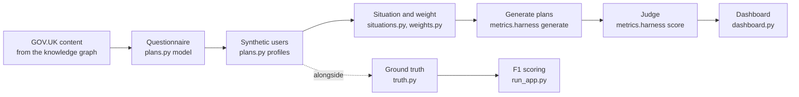

# Automatic evaluation of the planner

This document explains how we test the Personalised Planning planner without a
person reading every plan. It covers the whole process: building synthetic users
from GOV.UK content, generating plans with the hosted planner, judging them, and
reading the results. It ends with what the example run on 28 October 2026 found,
and how far to trust it.

It is written for the whole team. The parts marked **Detail** go further into
how things are calculated; you can skip them and still follow the rest.

A slide version of this material, with interactive examples built from the same
run, is in [auto-evaluation-slides.html](auto-evaluation-slides.html). Open it in
a browser and use the arrow keys.

The command-line reference for every script is in the
[pipeline README](../README.md). This document explains the method and the
reasons behind it, and does not repeat every flag.

## Contents

1. [Why we evaluate automatically](#1-why-we-evaluate-automatically)
2. [The process at a glance](#2-the-process-at-a-glance)
3. [Synthetic users](#3-synthetic-users)
4. [Two ways to score a plan](#4-two-ways-to-score-a-plan)
5. [The metrics harness](#5-the-metrics-harness)
6. [Relevance](#6-relevance)
7. [Consistency](#7-consistency)
8. [Keeping the judge honest](#8-keeping-the-judge-honest)
9. [Weighting profiles to real users](#9-weighting-profiles-to-real-users)
10. [Reading the results](#10-reading-the-results)
11. [Example run: learning to drive, 28 October 2026](#11-example-run-learning-to-drive-28-october-2026)
12. [How far to trust these numbers](#12-how-far-to-trust-these-numbers)
13. [Running it yourself](#13-running-it-yourself)
14. [Open questions and next steps](#14-open-questions-and-next-steps)
15. [File map](#15-file-map)

---

## 1. Why we evaluate automatically

A personalised plan can go wrong in two ways.

- **It is wrong for this person.** It tells someone to apply for a licence they
  already hold, or it includes a step that has nothing to do with them. We
  measure this as **relevance**.
- **It changes every time.** Ask the planner twice for the same person and you
  may get two plans with a different number of steps, or a different fee for the
  same service. People can't act on a plan they can't rely on. We measure this as
  **consistency**.

Reading plans by hand doesn't scale. Every change to the planner's prompt, model
or tools needs checking again, across many different kinds of user. So the
checks run as code. An AI judge makes the calls that need judgement, and every
call is saved with its reason so a person can check it.

## 2. The process at a glance



| Stage | What happens | Who does the work |
|---|---|---|
| 1. GOV.UK content | The pages for one life event, taken from the knowledge graph. 92 pages for driving. | Input |
| 2. Questionnaire | The questions whose answers change what a person must do. | Claude drafts, code checks, a person reviews |
| 3. Synthetic users | One profile for every distinct set of answers. 90 for driving. | Code |
| 4. Situation and weight | A sentence saying what each user wants, and how common they are among real users. | Code |
| 5. Generate plans | The hosted planner is asked for several plans per profile. | The live planner |
| 6. Judge | Each plan is judged for relevance, and each profile's plans for consistency. | Claude, as a judge |
| 7. Dashboard | One HTML page with every score and every reason the judge gave. | Code |

Alongside stages 3 to 5 there is a second, older scoring route that compares
plans with GOV.UK's published step by steps. Section 4 explains how the two
differ.

## 3. Synthetic users

Files: [plans.py](../plans.py), [prompts.py](../prompts.py),
[summary.py](../summary.py), [situations.py](../situations.py).

We test with made-up users so that we can cover every route through the
guidance, rerun the same users after every change, and avoid using anyone's
real data.

**The content decides the questions.** Claude reads the guidance for a life event
and proposes only questions where the answer changes what a person must do. Each
question has to cite the page that justifies it. The current driving
questionnaire has 15 questions and 21 derived facts (named conditions such as
"needs a theory test" that combine several answers).

**Code checks the questionnaire.** Ordinary code invents thousands of answer
sets and checks that every question can be reached, every answer can occur and
every rule changes something. Problems go back to Claude to fix, for up to three
rounds. A person then reviews the questionnaire and can edit it by hand.
`plans.py` writes a readable summary, with a diagram of which questions lead to
which, to help with that review.

**Code builds the users.** It walks the questionnaire 20,000 times, answering
differently each time, and keeps one profile for each distinct set of answers.
For driving that gives 90 profiles, and every possible answer appears at least
once. Rare routes are covered on purpose, because that is where personalised
plans tend to go wrong.

**Nobody impossible.** Age isn't asked, so it is worked out from the answers.
Someone who passed a driving test before 1997 can't be 19.

**Each user gets a situation.** In production the planner receives a sentence
saying what the person wants help with. `situations.py` picks that sentence from
the profile's answer to the main-goal question, from a hand-written list.

This is what the planner receives for profile P085:

```json
{
  "situation": "I want to learn to drive or ride, from getting my provisional licence to passing my test.",
  "user_context": {
    "today": "28 October 2026",
    "q_main_goal": "learn_to_drive",
    "q_vehicle_type": "car",
    "q_have_provisional": "yes",
    "q_has_theory_cert": "yes",
    "q_accessibility_need": "no",
    "q_pip_mobility": "no",
    "age": 27
  }
}
```

The derived facts are not sent, so the planner has to work out the route from
the answers, as it would for a real user.

Nothing in this code is about driving. The same scripts have produced a
questionnaire for having a baby.

**Limit.** This tells us which journeys exist, not how common they are. Section 9
covers how we weight profiles to reflect real users.

## 4. Two ways to score a plan

| | Against ground truth | With an AI judge |
|---|---|---|
| Files | [truth.py](../truth.py), [run_app.py](../run_app.py) | [metrics/](../metrics/) |
| Answer key | GOV.UK's published "Learn to drive a car" step by step. Each of its 7 steps is marked required, not required or blocked for each profile. | None. The judge reads each plan against the person's situation and answers. |
| What it measures | Which of the guide's steps the plan covers: precision, recall and F1. Showing someone a step they are legally blocked from is counted separately, outside F1. | Whether each task is relevant to this person, and whether one person's plans agree with each other. |
| Where AI is used | Drafting about eight rules that link the guide's steps to the questionnaire. A person checks them once; code then applies them to every profile. | Every judgement. Each comes with a written reason. |
| Repeatability | Exact. Scoring is pure code, so reruns are free and identical. | Each judgement runs N times, and scores show their range. |
| Who it covers | Only who a published step by step covers: car learners in Great Britain. | Any profile with a situation, for any life event. |

The two complement each other. Ground truth is the more authoritative check,
because the answer key comes from GDS's own published guidance, but it only
works where a step by step exists and only measures which steps were included.
The judged metrics cover the rest: whether the content of a plan fits the
person, and whether the planner is stable.

The rest of this document is about the judged metrics. The README covers
[ground truth](../README.md#part-2--ground-truth-and-scoring-truthpy) and
[F1 scoring](../README.md#part-3--calling-the-planner-agent-run_apppy) in full.

## 5. The metrics harness

Files: [metrics/harness.py](../metrics/harness.py),
[metrics/agent_calls.py](../metrics/agent_calls.py),
[metrics/bedrock_judge.py](../metrics/bedrock_judge.py),
[metrics/aggregate.py](../metrics/aggregate.py).

The harness runs in two separate steps, so the slow part only happens once.

**Generate** (`python -m metrics.harness generate`) asks the hosted planner for
`G` plans per profile. It calls the planner the way the backend does: the
situation, the answer codes, age and today's date, in a fresh session each time.
Each call can take minutes. The plans file is saved after every profile, so an
interrupted run keeps what it has done. Throttling, server errors, timeouts and
empty replies are retried, waiting 5s, then 10s, and so on up to 60s. Errors that
won't fix themselves, such as access denied, fail at once.

**Score** (`python -m metrics.harness score`) reads a plans file, runs each judge
`N` times, and writes `results.json`. Judging is quick, so you can score the same
plans again after changing a judge prompt, without asking the planner for new
plans.

Two settings control cost and how much to trust the result:

- `G`, plans per profile. Consistency needs at least 2. The default is 3.
- `N`, judge runs per measure. Running the judge more than once shows how much
  its verdicts vary.

The planner's model and the judge's model are set separately, with no fallback
between them: `ANTHROPIC_MODEL` for the planner (set in `agentcore.json`) and
`EVAL_ANTHROPIC_MODEL` for the judge. The harness refuses to score if the judge
model isn't set, so the choice of judge is always deliberate.

## 6. Relevance

Files: [metrics/relevance.py](../metrics/relevance.py),
[metrics/relevance_prompt.md](../metrics/relevance_prompt.md).

Relevance asks whether each task belongs in this person's plan. The judge makes
one call per plan and gives every task one of three verdicts, deciding in this
order:

1. Does the task's subject serve the situation at all? If not, it is
   **irrelevant**.
2. Does one of the person's answers rule it out (already done, not eligible, a
   different vehicle)? If so, it is **contradicted**.
3. Otherwise the task is needed, now or later in the journey, so it is
   **relevant**.

**What the judge sees:** the situation in the person's own words; their answers
as codes, their age and today's date; and each task's title, summary, GOV.UK
service name and link.

**What the judge doesn't see:** the planner's reasoning, any answer key or
published step by step, and each step's status (for example "Done"). The last
of these turns out to matter a great deal; see section 11.

**Score.** A plan's score is the share of its judged tasks that are relevant. A
task the judge couldn't give a usable verdict for is marked *unjudged* and left
out.

> **Detail.** For each profile: average the N runs within each plan, then
> average the plans. `scores_by_plan`, `min` and `max` show how much a profile's
> plans differ; `repeat_range` shows how much the judge's runs differ. The
> overall figure is the mean of the per-profile scores, not a pooled count of
> tasks, so every profile counts equally (before weighting).

## 7. Consistency

Files: [metrics/consistency.py](../metrics/consistency.py),
[metrics/services.py](../metrics/services.py),
[metrics/fact_consistency_prompt.md](../metrics/fact_consistency_prompt.md),
[metrics/structure_consistency_prompt.md](../metrics/structure_consistency_prompt.md).

Consistency compares one person's `G` plans. A plan has three layers (a summary
and a list of steps; tasks inside the steps, each pointing to a GOV.UK service;
and facts about each service, such as its cost), so there are three measures,
one for each layer. Each picks up something the other two can't.

| Measure | Question it answers | How |
|---|---|---|
| **Service stability** | Do the plans recommend the same GOV.UK services? | Code, no judge. For each pair of plans, the services in both divided by the services in either (Jaccard overlap, matched by link), then averaged over the pairs. |
| **Fact consistency** | Where plans share a service, do they contradict each other about it? | Judge, one call per service that appears in two or more plans. It compares cost, department, deadline, requirements, how to apply and so on. |
| **Structure consistency** | Do the plans have the same number of steps, covering the same things in the same order, with summaries describing the same route? | Judge, one call per pair of plans. A pair counts as the same only if the judge lists no differences. |

Each score is a share between 0 and 1, where 1 means fully consistent.

**What doesn't count as a contradiction:** one plan giving detail another leaves
out, the same fact in different words, or a vague claim beside a compatible
specific one ("soon" and "within 5 days"). For structure, wording doesn't count,
and neither do the services or facts inside the steps, because the other two
measures cover those.

> **Detail.** With three or four services per plan, one extra service moves a
> pair's overlap by about 0.25, so small differences in service stability
> between runs are noise. Averaging over pairs, rather than comparing all plans
> at once, keeps the score from falling just because more plans were generated.
> Judged scores are the mean over N runs, with `*_range` giving the lowest and
> highest run.

## 8. Keeping the judge honest

An AI judge can be wrong, so the harness is built to make its mistakes visible
and to stop them from quietly shifting the scores.

- **Reason first.** The judge writes one sentence naming the answer or part of
  the situation it relied on, and only then gives its verdict. Every verdict in
  the results has its reason next to it.
- **Examples from elsewhere.** The relevance and structure prompts use a
  bereavement as their worked example, and the fact prompt uses a different
  service, so the examples show where the boundaries are without hinting at
  driving answers.
- **Answers read literally.** A missing answer counts as unknown, never as "no".
- **Plans are data.** The person's details and the plans are wrapped in tags
  marked as data, so text inside a plan can't give the judge instructions.
- **Order shuffled.** When the judge compares two plans, they are shown in a
  random order that is fixed by a seed, so reruns match and any lean towards the
  plan shown first cancels out.
- **Judged more than once.** Every judgement runs N times, and the results report
  the lowest and highest run.
- **Failures stay visible.** A judge call that fails (for example through
  throttling) or whose reply can't be read is tried up to twice more. If it
  still fails, the task, pair or service is marked *unjudged*, given the error as
  its reason, and left out of the score. It is never counted as a pass or a
  fail. The count of unjudged items is printed and shown on the dashboard.
- **Bad credentials stop the run.** Access denied, or missing or expired AWS
  credentials, end scoring straight away with no results written, rather than
  producing a file full of unjudged items.
- **No secrets in results.** `results.json` never contains the planner's runtime
  ARN, which includes the AWS account ID.

## 9. Weighting profiles to real users

File: [weights.py](../weights.py). Targets:
`data/weights/driving_weights_v2.json`, with sources in
`data/examples_ltd/driving_weights_v2_methodology.md`.

The synthetic profiles cover every route once, so a rare route counts as much as
a common one. That's right for finding bugs, but it doesn't tell us how the
planner does for a typical user. `weights.py` gives each profile a weight so
that, for each targeted question, each answer's share of the weight matches the
share among real users. It does this by **raking**: rescale the weights to fit
one question, then the next, and repeat until nothing moves.

The driving targets (version 2) are:

| Answer | Target share | Source |
|---|---|---|
| Learning to drive a car, in Great Britain | 100% | Scope of the GOV.UK "Learn to drive a car" journey; everything else gets no weight |
| Already has a provisional licence | 85.3% | DVLA first-provisional applications against DVSA theory and practical test volumes |
| Already passed the theory test | 33.6% | The same volumes |
| Needs support at the theory test | 12% | Assumption, anchored to Census 2021 disability figures for younger people |
| Gets the higher rate of PIP mobility | 1.5% | Assumption; no public figures for learner drivers |

The stage shares use transaction volumes as a stand-in for how many people are
at each stage. Test volumes include repeat attempts, so these are rough.

`generate` skips profiles weighted under 0.5% (`--min-weight 0.005`), since they
can't move a weighted score enough to be worth a planner call. The results then
report a **weighted** score next to the plain mean for every measure, and
`coverage.weight_scored` shows how much of the total weight was actually scored.

**Effective sample size** (`1 / Σw²`) says how many equally weighted profiles the
weighted result is worth. Below about 15, a handful of profiles carry the
result.

## 10. Reading the results

File: [dashboard.py](../dashboard.py), template
[dashboard_template.html](../dashboard_template.html).

`dashboard.py` turns every results file in a folder into one HTML page that works
offline and needs nothing beyond Python. For each run it shows:

- the settings and coverage, with warnings for skipped profiles, profiles below
  the minimum weight, and unjudged items;
- the mean and weighted mean for each measure, and the lowest-scoring profile;
- each profile's scores and their spread;
- the services most often marked contradicted or irrelevant;
- the evidence: every flagged task with the judge's reason, every fact
  contradiction, every structural difference, and services missing from some
  plans;
- for a chosen profile, its answers, the services in each plan and every task's
  verdict.

The scores tell you where to look. The evidence tells you what actually happened,
and as the next section shows, it can change the conclusion.

## 11. Example run: learning to drive, 28 October 2026

The committed example is `data/examples_ltd/results_w2.json`.

### Set-up

| | |
|---|---|
| Profiles | 90 generated; 16 in scope (car learners in Great Britain); 9 scored. The other 81 were under the minimum weight, and the 9 scored hold 99.2% of the weight. |
| Plans | G = 3 per profile, so 27 plans from the hosted planner |
| Judge | Claude Sonnet 5.5 on Bedrock, N = 2 runs per measure |
| Judge calls | 164: 54 relevance (27 plans × 2), 54 structure (27 pairs × 2), 56 fact checks |
| Unjudged | 3 of 172 task judgements (one plan's reply couldn't be read) |
| Effective sample size | 3.1 |

### Scores

| Measure | Mean of 9 profiles | Weighted |
|---|---|---|
| Relevance | 0.72 | 0.62 |
| Service stability | 0.88 | 0.96 |
| Fact consistency | 0.91 | 0.97 |
| Structure consistency | 0.41 | 0.69 |

The weighted scores lean heavily on two profiles: P071 holds 49% of the weight
and P085 holds 25%.

### By profile

Heaviest weight first. Each score is the mean over the profile's 3 plans and the
judge's 2 runs.

| Profile | Weight | Has provisional | Passed theory | Relevance | Service stability | Fact consistency | Structure consistency |
|---|---|---|---|---|---|---|---|
| P071 | 49.1% | Yes | No | 0.67 | 1.00 | 1.00 | 1.00 |
| P085 | 24.8% | Yes | Yes | 0.33 | 1.00 | 1.00 | 0.50 |
| P032 | 8.5% | No | No | 0.92 | 0.83 | 1.00 | 0.33 |
| P057 | 6.7% | Yes | No | 0.76 | 0.83 | 0.67 | 0.33 |
| P069 | 4.3% | No | Yes | 1.00 | 0.78 | 1.00 | 0.00 |
| P066 | 3.4% | Yes | Yes | 0.25 | 1.00 | 1.00 | 0.33 |
| P045 | 1.2% | No | No | 1.00 | 1.00 | 0.83 | 1.00 |
| P035 | 0.7% | Yes | No | 0.65 | 0.67 | 1.00 | 0.00 |
| P018 | 0.6% | No | Yes | 0.92 | 0.83 | 0.67 | 0.17 |

### What the evidence shows

**Most of the lost relevance comes from the metric, not the planner.** The
planner usually keeps steps the person has already completed in the plan, and
marks them `status: "Done"`. For example, P085 already holds a provisional
licence, and their plan has a step "Hold a provisional driving licence", marked
Done, containing the task "Apply for a provisional driving licence". The
relevance judge is never shown a step's status, so it reads the task as advice to
apply again and calls it contradicted.

| Step status | Relevant | Contradicted | Irrelevant | Unjudged |
|---|---|---|---|---|
| Done (48 judgements) | 12 | 35 | 0 | 1 |
| Not started (124 judgements) | 106 | 0 | 16 | 2 |

All 35 contradicted verdicts were on steps the planner had already marked Done.
When a done step was worded as upkeep, such as "Keep your theory certificate
ready", the judge called it relevant instead (12 times), so the verdict also
depends on how the planner happened to phrase the task.

Leaving Done steps out of relevance changes the scores a lot:

| | As reported | Done steps left out |
|---|---|---|
| Mean | 0.72 | 0.89 |
| Weighted | 0.62 | 0.97 |

These figures were recalculated from the saved plans for this document. The
harness doesn't do this calculation. A related detail: tasks under Done steps
still have `completed: false`, so the task-level flag and the step-level status
disagree.

**Vehicle tax comes and goes.** "Tax your vehicle" appeared in 8 of the 27
plans, and in all three plans for only one profile (P066). The judge called it
irrelevant every time (16 of 16), because nothing says the learner owns a car.
It accounts for 4 of the 6 services that appear in some of a profile's plans but
not others.

**Fees on completed steps change between plans.** For P018, a theory test
already passed cost £23 in one plan and £0 in the other two. For P057, a
provisional licence already held cost £34 in one plan and £0 in two. The fact
judge flagged both in both of its runs. Across profiles the same thing happens:
some plans give the fee of a completed step, others give £0.

**One genuine rule contradiction, caught in one of two runs.** For P045, one plan
said a pass lapses if you don't hand your provisional licence to the examiner;
the other two said you can still claim the full licence with form D1. The judge
flagged this in one of its two runs, which shows why each check runs more than
once.

**Plan shape varies most.** Only 22 of 54 pair judgements found the same
structure. Steps appear and disappear (vehicle tax, completed steps), and the
summaries mention different things. Which services the plans recommend (0.88)
and what they say about them (0.91) were much more stable.

## 12. How far to trust these numbers

- **A small, lopsided sample.** 9 profiles with an effective sample size of 3.1.
  P071 alone holds 49% of the weight, so the weighted scores mostly describe P071
  and P085. The weights methodology traces this to the profile set, where the
  most common combination of answers happens to have a single 45-year-old
  profile. Treat the weighted scores as provisional.
- **Some profiles can't exist.** P018 and P069 have passed the theory test
  without a provisional licence, which isn't possible in Great Britain. Together
  they hold 4.9% of the weight.
- **Three plans per person is few.** One extra service moves a pair's overlap by
  about 0.25, and structure scores per profile can only take a few values.
- **The judge reacts to wording**, as the Done-step finding shows.
- **Some weights are assumptions.** There are no public figures for accessibility
  needs or PIP among learner drivers, and the stage shares use transaction
  volumes as a stand-in.
- **Faithfulness isn't measured.** Checking a plan against what the knowledge
  graph returned would need the planner's tool results, and the hosted planner
  returns only the plan.

## 13. Running it yourself

From `scripts/evaluation/plan-generation`, for a weighted run:

```bash
# 1. weight the profiles (after situations.py has added a situation to each)
python weights.py data/profiles/driving_profiles_v5.json data/weights/driving_weights_v2.json \
    -o data/profiles/driving_profiles_v5_w2.json

# 2. ask the hosted planner for 3 plans per profile
python -m metrics.harness generate data/profiles/driving_profiles_v5_w2.json -G 3 -o data/plans.json

# 3. judge each measure twice
python -m metrics.harness score data/plans.json -N 2 --results-out data/results/results_w2.json

# 4. build the dashboard from every results file in data/results/
python dashboard.py
open data/results/dashboard.html
```

What each step needs:

- `generate` needs `AGENT_RUNTIME_ARN` (or `--agent-runtime-arn`) and AWS
  credentials allowed to invoke the hosted planner, for example under
  `aws-vault exec`.
- `score` needs `EVAL_ANTHROPIC_MODEL` (or `--judge-model`) and Bedrock access for
  the judge. It doesn't need the planner.
- `dashboard.py` needs only Python and works offline.

When working on a judge prompt, score a single profile and a single measure,
for example `python -m metrics.harness score data/plans.json --profile P013
--metrics relevance`. The plans are already saved, so this costs only the judge
calls.

**Before sharing anything:** plans files record the runtime ARN, which includes
the AWS account ID. Results files and the dashboard never do, but they contain
local file paths and the judge's text about each plan.

The [README](../README.md) has every flag, the plans and results file formats,
and the full retry rules.

## 14. Open questions and next steps

### Decisions this run raises

- **Should a plan show steps the person has already done?** If yes, the relevance
  judge should be shown each step's status, or Done steps should be left out of
  the relevance score. If no, the planner should drop them. Either way the
  current relevance score understates the planner.
- **Should a completed step show its fee or £0?** Either works, as long as plans
  agree.
- **Should learners see vehicle tax?** Decide, and tell the planner, so it stops
  adding it to some plans and not others.

### From the weighting review

These come from `driving_weights_v2_methodology.md`:

- Regenerate the in-scope car profiles with realistic combinations, so nobody has
  a theory pass without a provisional licence, and sample accessibility and PIP
  together rather than independently.
- Add age as a weighting dimension, or create several personas per set of answers
  across age bands.
- Replace the stand-in shares with GOV.UK page analytics or a learner-driver
  survey.
- Report how much the scores move with accessibility at 8% and 16%, and PIP
  mobility at 0.5% and 3%.
- Keep the car-only scope separate from any broader driving-services evaluation.

### Not built yet

- **Faithfulness**: checking a plan against the knowledge-graph results the
  planner saw. This needs the hosted planner to return its tool-call results.

## 15. File map

All paths are relative to `scripts/evaluation/plan-generation/`.

| File | Role |
|---|---|
| [plans.py](../plans.py) | Builds the questionnaire from GOV.UK content (`model`), then synthetic profiles and review packets (`profiles`) |
| [prompts.py](../prompts.py) | The Claude prompts and tool schemas used by `plans.py` and `truth.py` |
| [summary.py](../summary.py) | Writes the readable Markdown summary of a questionnaire, with a branching diagram |
| [situations.py](../situations.py) | Adds a first-person situation sentence to every profile |
| [weights.py](../weights.py) | Weights profiles to target answer shares by raking; optional weighted sampling |
| [truth.py](../truth.py) | Ground truth: maps a GOV.UK step by step onto the questionnaire, builds answer keys, scores plans |
| [run_app.py](../run_app.py) | Calls the hosted planner and scores its plans against ground truth; shared helpers for calling the planner |
| [metrics/harness.py](../metrics/harness.py) | The `generate` and `score` commands |
| [metrics/agent_calls.py](../metrics/agent_calls.py) | One planner call, with retries for temporary failures |
| [metrics/bedrock_judge.py](../metrics/bedrock_judge.py) | The judge: one prompt in, one reply out, Claude on Bedrock |
| [metrics/relevance.py](../metrics/relevance.py) | The relevance measure |
| [metrics/consistency.py](../metrics/consistency.py) | The fact and structure consistency measures |
| [metrics/services.py](../metrics/services.py) | Which services a plan recommends; the service stability measure |
| [metrics/aggregate.py](../metrics/aggregate.py) | Averages over G and N, weighted scores, and the shape of `results.json` |
| [metrics/retry.py](../metrics/retry.py) | Which judge errors are retried, which are marked unjudged, and which stop the run |
| [metrics/*_prompt.md](../metrics/) | The three judge prompts |
| [dashboard.py](../dashboard.py) | Builds the HTML dashboard from a folder of results files |
| `data/examples_ltd/` | The committed example: profiles, weights and methodology, results and dashboard |
